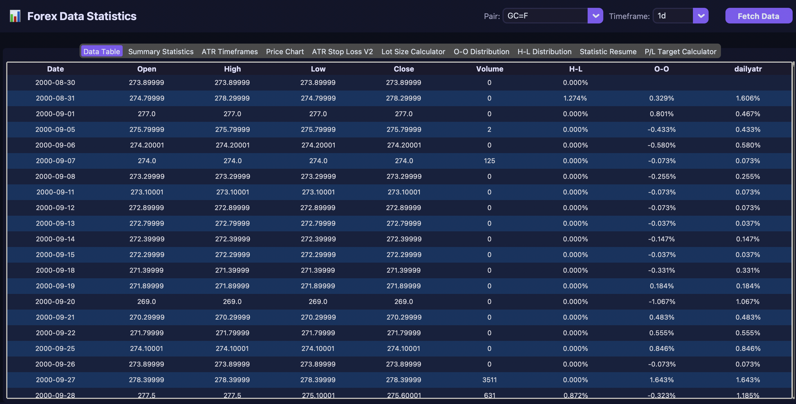
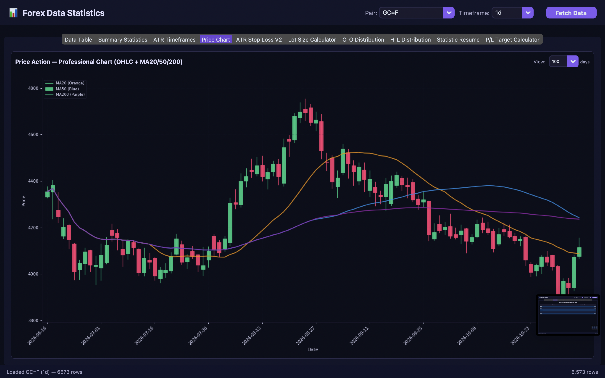
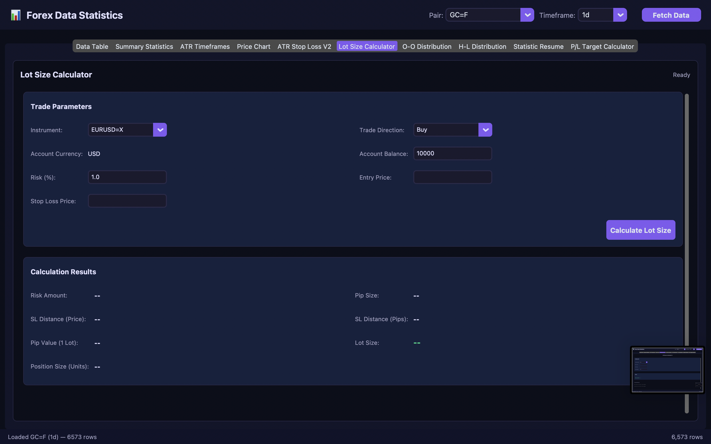
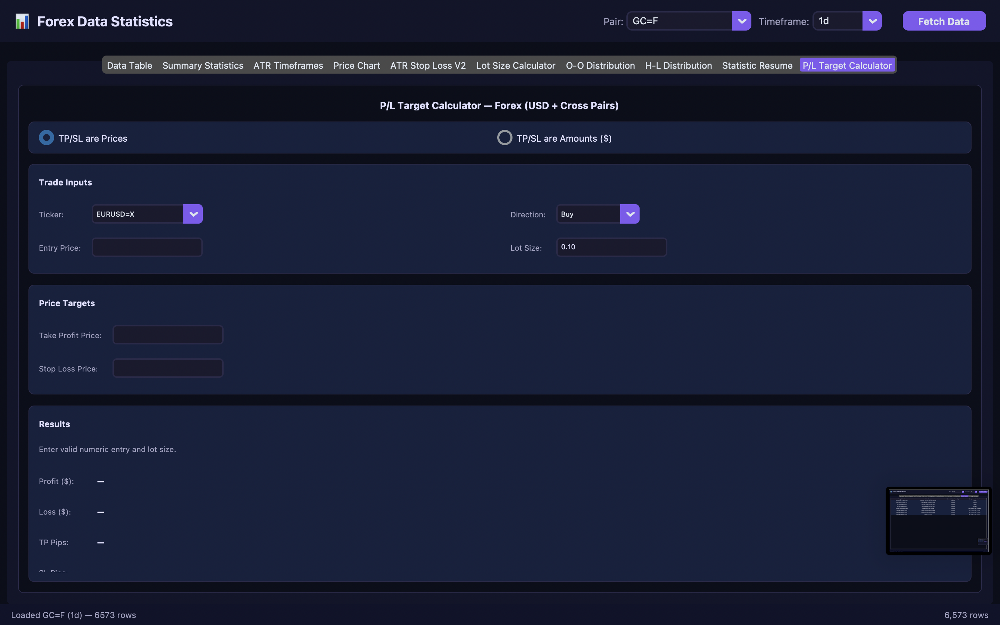
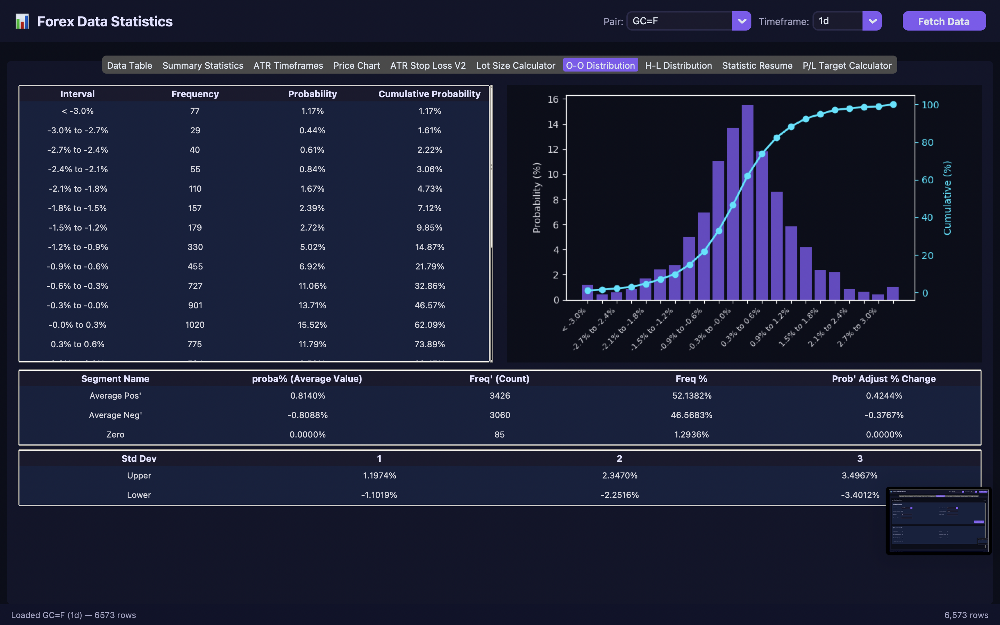
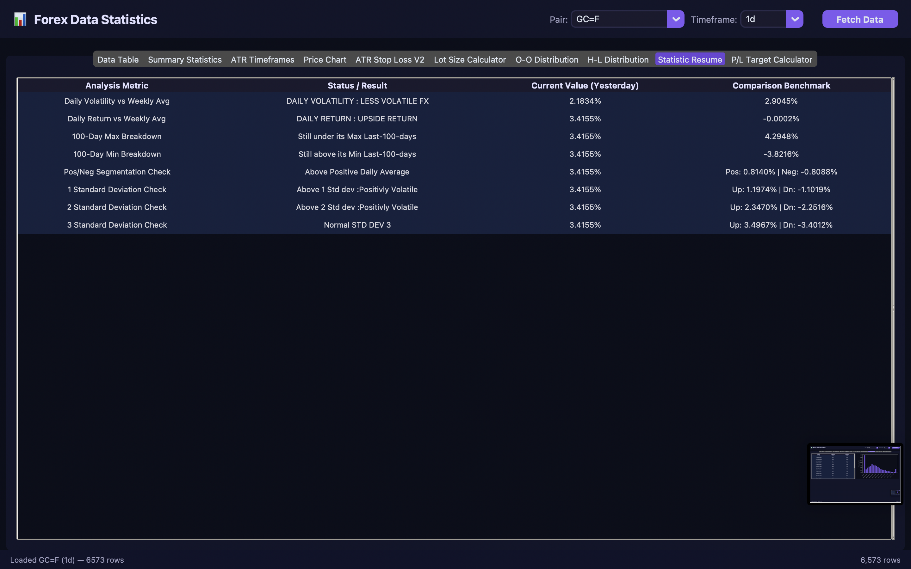

# 📊 Forex Data Statistics & Quantitative Trading Suite

[](https://www.python.org/)
[](https://customtkinter.tomschimansky.com/)
[](https://finance.yahoo.com/)
[](LICENSE)
[](https://github.com/)

A high-performance desktop application for quantitative Forex analysis, historical volatility modeling, statistical distribution profiling, and risk management. Built with **Python**, **CustomTkinter**, **Pandas**, and **Matplotlib**, this tool delivers institutional-grade trade planning tools including multi-timeframe ATR modeling, dynamic lot sizing, and dual-mode P/L target calculations across 28+ Forex pairs, commodities, and crypto assets.

---

## 📑 Table of Contents

- [Overview](#-overview)
- [Key Features](#-key-features)
  - [1. High-Performance Data Table](#1-high-performance-data-table)
  - [2. Summary Statistics Engine](#2-summary-statistics-engine)
  - [3. Trailing ATR Timeframes](#3-trailing-atr-timeframes)
  - [4. Candlestick Price Action Chart](#4-candlestick-price-action-chart)
  - [5. ATR Stop Loss Calculator V2](#5-atr-stop-loss-calculator-v2)
  - [6. Generic Lot Size & Position Calculator](#6-generic-lot-size--position-calculator)
  - [7. Institutional P/L Target Calculator](#7-institutional-pl-target-calculator)
  - [8. O-O & H-L Statistical Distributions](#8-o-o--h-l-statistical-distributions)
  - [9. Statistical Resume (Executive Insights)](#9-statistical-resume-executive-insights)
- [Supported Instruments & Timeframes](#-supported-instruments--timeframes)
- [Mathematical Foundations](#-mathematical-foundations)
- [Technologies Used](#-technologies-used)
- [Project Structure](#-project-structure)
- [Prerequisites & Requirements](#-prerequisites--requirements)
- [Installation Guide](#-installation-guide)
- [How to Run](#-how-to-run)
- [Running Unit Tests](#-running-unit-tests)
- [Usage Workflow Guide](#-usage-workflow-guide)
- [Screenshots](#-screenshots)
- [Contributing](#-contributing)
- [License](#-license)
- [Disclaimer](#-disclaimer)

---

## 🔭 Overview

Retail and institutional traders often lack fast, accessible statistical tools to quantify price behavior before executing orders. **Forex Data Statistics** bridges this gap by combining real-time historical data ingestion with descriptive statistical models and interactive execution calculators:

- **Asynchronous Data Architecture**: Downloads multi-year OHLCV records in background worker threads without freezing the user interface.
- **Parametric Volatility Profiling**: Computes true range metrics (J. Welles Wilder ATR), day-over-day open price changes, and intraday price spread distributions.
- **Execution & Risk Management**: Translates statistical findings directly into actionable parameters (exact position size, ATR-based stop losses, profit targets, and risk-reward ratios).
- **Modern Cyber Dark Theme**: Ergonomically crafted CustomTkinter dark interface (`#0b0e1a` base with `#7f5af0` accent) designed for extended trading sessions.

---

## 🌟 Key Features

### 1. High-Performance Data Table
- Integrated `ttk.Treeview` styled with dark palettes, capable of scrolling through 10,000+ historical rows with zero latency.
- Features formatted data columns: `Date`, `Open`, `High`, `Low`, `Close`, `Volume`, `H-L %`, `O-O %`, and `Daily ATR %`.
- Automated rounding precision (5 decimals for quotes, 3 decimals for percentages).

### 2. Summary Statistics Engine
- Evaluates 13 descriptive statistical metrics computed exclusively on complete historical candles (excluding the in-progress candle):
  - **Count**, **Mean / Average**, **Standard Error (`sem`)**, **Median**, **Mode**
  - **Standard Deviation**, **Sample Variance**, **Kurtosis**, **Skewness**
  - **Range**, **Minimum**, **Maximum**, **Sum**
- Partitioned into three side-by-side analytical grids: **H-L (Intraday Spread)**, **O-O (Interday Shift)**, and **Daily ATR (Wilder Volatility)**.

### 3. Trailing ATR Timeframes
- Tracks rolling volatility over institutionally recognized trading cycles:
  - **1 Week** (5 bars)
  - **1 Month** (21 bars)
  - **3 Months** (63 bars)
  - **1 Year** (252 bars)
  - **2 Years** (504 bars)
- Enables immediate detection of volatility regime expansion and contraction.

### 4. Candlestick Price Action Chart
- Matplotlib canvas integrated natively into the CustomTkinter GUI.
- Dual-axis layout featuring:
  - Japanese Candlestick bars with distinct bullish (`#00d084`) and bearish (`#ff3d71`) coloring.
  - Three trend-filtering Moving Averages: **MA20** (short-term), **MA50** (intermediate), and **MA200** (long-term baseline).
  - Trading volume bars aligned with each price bar.
- Interactive lookback selector: **30**, **50**, **100**, **250**, **500**, or **All** periods.

### 5. ATR Stop Loss Calculator V2
- Calculates volatility-adjusted invalidation levels to avoid stop-hunting noise.
- Supports both **Buy** (Long) and **Sell** (Short) order directions.
- Configurable **ATR Value** and customizable **ATR Multiplier** (e.g., 1.5×, 2.0×, 3.0×).

### 6. Generic Lot Size & Position Calculator
- Fully parameterized position-sizing calculator tailored to any supported instrument.
- Computes:
  - **Risk Amount in USD** based on Account Balance and Risk Percentage.
  - **Stop Loss Distance** in price points and pips.
  - **Pip Value (1 Standard Lot)** fetched dynamically via live quote conversion rates.
  - **Optimal Lot Size** formatted in Standard Lots, Mini Lots, Micro Lots, and total contract units.

### 7. Institutional P/L Target Calculator
- Comprehensive profit and loss engine handling both USD majors and cross currency pairs.
- **Dual Calculation Modes**:
  1. **Prices Mode**: Input Entry Price, Lot Size, Take Profit (TP) Price, and Stop Loss (SL) Price $\rightarrow$ calculates exact TP/SL in pips, expected Dollar profit, maximum Dollar risk, and the Risk-Reward Ratio (R:R).
  2. **Amounts Mode**: Input Entry Price, Lot Size, Target Profit ($), and Maximum Loss ($) $\rightarrow$ calculates the exact TP and SL price levels to enter in your brokerage terminal.
- Automated currency resolution for:
  - **USD Quote Pairs** (EURUSD, GBPUSD, AUDUSD, NZDUSD)
  - **USD Base Pairs** (USDJPY, USDCHF, USDCAD)
  - **Cross Pairs** (EURGBP, EURJPY, GBPJPY, AUDCAD, etc.) with real-time conversion rates to USD.

### 8. O-O & H-L Statistical Distributions
- **O-O Distribution**:
  - Binned frequency table with individual and cumulative probabilities.
  - Combined bar chart (probability density) and line plot (cumulative probability).
  - Conditional probability table (Positive vs. Negative days and adjustment probabilities).
  - Standard Deviation Volatility Bands ($\pm 1\sigma, \pm 2\sigma, \pm 3\sigma$).
- **H-L Distribution**:
  - Binned frequency intervals and probability chart for price ranges.

### 9. Statistical Resume (Executive Insights)
- High-level decision-support dashboard:
  - **Daily Volatility Status**: Evaluates whether current volatility is elevated (`Volatile FX`) or subdued (`Less Volatile FX`) against the 5-day rolling average.
  - **Daily Return Bias**: Identifies `Upside Return` vs. `Downside Return` against the weekly benchmark.
  - **100-Period Extremes**: Trailing 100-candle maximum and minimum boundaries.
  - **Probability & Band Reference**: Quick lookup of average positive/negative outcomes and standard deviation bounds.

---

## 🌐 Supported Instruments & Timeframes

### Supported Instruments

| Category | Symbols / Tickers |
| :--- | :--- |
| **Forex Majors (USD Quote)** | `EURUSD=X`, `GBPUSD=X`, `AUDUSD=X`, `NZDUSD=X` |
| **Forex Majors (USD Base)** | `USDJPY=X`, `USDCAD=X`, `USDCHF=X` |
| **EUR Crosses** | `EURGBP=X`, `EURJPY=X`, `EURCHF=X`, `EURAUD=X`, `EURNZD=X` |
| **GBP Crosses** | `GBPAUD=X`, `GBPJPY=X`, `GBPCHF=X`, `GBPCAD=X`, `GBPNZD=X` |
| **AUD Crosses** | `AUDJPY=X`, `AUDCAD=X`, `AUDCHF=X`, `AUDNZD=X` |
| **NZD Crosses** | `NZDJPY=X`, `NZDCAD=X`, `NZDCHF=X` |
| **CAD & CHF Crosses** | `CADJPY=X`, `CADCHF=X`, `CHFJPY=X` |
| **Precious Metals** | `GC=F` (Gold / XAUUSD), `XAGUSD=X` (Silver) |
| **Energy & Crypto** | `CL=F` (WTI Crude Oil), `BTC-USD` (Bitcoin) |

### Supported Timeframes

| Timeframe | Source Interval | Ingestion Period | Processing Notes |
| :---: | :---: | :---: | :--- |
| **1m** | 1 minute | Trailing 7 days | Intraday resolution with timestamp formatting |
| **5m** | 5 minutes | Trailing 60 days | Intraday resolution with timestamp formatting |
| **15m** | 15 minutes | Trailing 60 days | Intraday resolution with timestamp formatting |
| **30m** | 30 minutes | Trailing 60 days | Intraday resolution with timestamp formatting |
| **1h** | 1 hour | Trailing 730 days | Intraday resolution with timestamp formatting |
| **4h** | 1 hour | Trailing 730 days | Resampled via Pandas aggregation (`Open`, `High`, `Low`, `Close`, `Volume`) |
| **1d** | 1 day | Maximum available | Full historical daily coverage |
| **1wk** | 1 week | Maximum available | Weekly macro trend analysis |
| **1mo** | 1 month | Maximum available | Monthly institutional cyclical analysis |

---

## 📐 Mathematical Foundations

### 1. True Range & Daily ATR % (J. Welles Wilder)
$$\text{TR}_t = \max\left( \text{High}_t - \text{Low}_t, \; |\text{High}_t - \text{Close}_{t-1}|, \; |\text{Low}_t - \text{Close}_{t-1}| \right)$$
$$\text{Daily ATR \%}_t = \left( \frac{\text{TR}_t}{\text{Close}_{t-1}} \right) \times 100$$

### 2. Relative Returns & Intraday Ranges
$$\text{O-O \%}_t = \left( \frac{\text{Open}_t - \text{Open}_{t-1}}{\text{Open}_{t-1}} \right) \times 100$$
$$\text{H-L \%}_t = \left( \frac{\text{High}_t - \text{Low}_t}{\text{Low}_t} \right) \times 100$$

### 3. Volatility Bands (Standard Deviation)
$$\text{Band}_{\text{Upper}, k} = \mu_{\text{O-O}} + (k \times \sigma_{\text{O-O}}) \quad (k \in \{1, 2, 3\})$$
$$\text{Band}_{\text{Lower}, k} = \mu_{\text{O-O}} - (k \times \sigma_{\text{O-O}}) \quad (k \in \{1, 2, 3\})$$

### 4. Position Sizing
$$\text{Risk Amount (\USD)} = \text{Balance} \times \left( \frac{\text{Risk \%}}{100} \right)$$
$$\text{Lot Size} = \frac{\text{Risk Amount (\USD)}}{\text{SL Distance (pips)} \times \text{Pip Value per Standard Lot (\USD)}}$$

### 5. Cross-Currency Profit & Loss Conversion
For a cross pair where quote currency $Q \neq \text{USD}$:
$$\text{P/L}_{\text{quote}} = (\text{Exit Price} - \text{Entry Price}) \times \text{Contract Size} \times \text{Lot Size}$$
$$\text{P/L}_{\text{USD}} = \text{P/L}_{\text{quote}} \times R_{Q \to \text{USD}}$$
where $R_{Q \to \text{USD}}$ is the current exchange rate converting 1 unit of quote currency to USD.

---

## 🛠 Technologies Used

- **Language**: Python 3.10+
- **GUI Framework**: [CustomTkinter](https://github.com/TomSchimansky/CustomTkinter) (version $\ge$ 5.2) — Modern, customizable Tkinter extension with native dark/light styling.
- **Native Widgets**: `tkinter.ttk` (Clam theme customization for high-throughput Treeviews).
- **Data Engineering**: [Pandas](https://pandas.pydata.org/) (version $\ge$ 2.0) — High-performance time-series resampling, rolling metrics, and frequency binning.
- **Numerical Computing**: [NumPy](https://numpy.org/) — Vectorized statistical routines.
- **Market Data Feed**: [yfinance](https://github.com/ranaroussi/yfinance) (version $\ge$ 0.2) — Historical market data ingestion from Yahoo Finance.
- **Visualization**: [Matplotlib](https://matplotlib.org/) (version $\ge$ 3.7) — Embedded candlestick charts, moving averages, volume bars, and distribution histograms.
- **Testing**: Built-in `unittest` suite for deterministic validation of financial calculations.

---

## 📂 Project Structure

```text
kok/
├── app.py                         # Main application window, layout, and threaded fetch orchestration
├── main.py                        # Application entry point
├── data_manager.py                # Yahoo Finance data fetcher, indicator calculations, and statistics
├── table_view.py                  # High-performance virtualized dark Treeview for OHLCV data
├── stats_view.py                  # 3-panel statistical summary view (H-L, O-O, Daily ATR)
├── atr_timeframes_view.py         # Multi-horizon trailing ATR rolling average table
├── candlestick_view.py            # Matplotlib candlestick chart with MA20/50/200 & volume
├── atr_stop_loss_v2_view.py       # Interactive ATR-based Stop Loss calculator
├── lot_size_calculator_view.py    # Multi-asset generic lot size & risk calculator
├── profit_loss_view.py            # Dual-mode (Prices vs. Amounts) Forex P/L target calculator
├── forex_pl_calculator.py         # Core mathematical engine for pip values, conversions, and targets
├── freq_views.py                  # Frequency distribution tables and charts (O-O and H-L)
├── resume_view.py                 # Executive comparative analysis and benchmarking table
├── test_forex_pl_calculator.py    # Unit tests for USD pairs and pip calculations
├── test_forex_pl_calculator_cross.py # Unit tests for cross pairs and dynamic currency conversion
├── requirements.txt               # Project dependencies
└── README.md                      # Comprehensive documentation
```

---

## 📋 Prerequisites & Requirements

- **Operating System**: macOS 10.15+, Ubuntu 20.04+ (or other modern Linux), Windows 10/11.
- **Python**: Version **3.10** or higher.
- **Internet Access**: Required during data fetching to download historical prices and quotes from Yahoo Finance.
- **Tkinter Support**: Python must be installed with Tkinter support (standard in official Python installers and Homebrew Python on macOS).

---

## 🚀 Installation Guide

### 1. Clone the Repository
```bash
git clone https://github.com/MrHaouari/Quantsmartpips.git
cd Quantsmartpips
```

### 2. Create and Activate a Virtual Environment

**On macOS / Linux:**
```bash
python3 -m venv .venv
source .venv/bin/activate
```

**On Windows:**
```powershell
python -m venv .venv
.venv\Scripts\activate
```

### 3. Install Dependencies
Install all required libraries using `pip`:
```bash
pip install --upgrade pip
pip install -r requirements.txt
```

Verify that all dependencies are installed:
```bash
pip list
```

---

## 💻 How to Run

Ensure your virtual environment is activated, then launch the app via `main.py`:

```bash
python main.py
```

The application window will initialize with the dark theme:
1. Select an instrument from the **Pair** dropdown (e.g., `EURUSD=X`, `GBPJPY=X`, `GC=F`).
2. Select a **Timeframe** (e.g., `1d`, `4h`, `1h`, `15m`).
3. Click **Fetch Data** (or switch pairs/timeframes to trigger automatic updates).
4. Navigate across the top tabs to explore analytics, charts, and calculators.

---

## 🧪 Running Unit Tests

The test suite validates the mathematical accuracy of pip sizing, rate conversion mechanisms, and P/L calculations.

Run all unit tests using Python's standard `unittest` test runner:

```bash
python -m unittest discover -v
```

To run individual test files:

```bash
# Test USD pairs calculations
python -m unittest test_forex_pl_calculator.py -v

# Test Cross pairs calculations and rate conversions
python -m unittest test_forex_pl_calculator_cross.py -v
```

---

## 📖 Usage Workflow Guide

### Workflow 1: Market Volatility Assessment
1. Select your target currency pair (e.g., `EURUSD=X`) and timeframe (`1d`).
2. Click **Fetch Data**.
3. Navigate to **ATR Timeframes** to compare current volatility against 1-week, 1-month, and 1-year trailing averages.
4. Check **Statistic Resume** to verify whether today's regime is classified as `Volatile FX` or `Less Volatile FX`.

### Workflow 2: Trend & Price Action Confirmation
1. Open the **Price Chart** tab.
2. Select your desired candle view range (e.g., `100` or `250` bars).
3. Observe price action relative to the **MA20**, **MA50**, and **MA200** lines, alongside volume confirmation.

### Workflow 3: Volatility-Based Stop Loss Sizing
1. Switch to **ATR Stop Loss V2**.
2. Select trade direction (**Buy** or **Sell**).
3. Input your planned **Entry Price** and the current **ATR Value** (obtained from the Summary Statistics or ATR Timeframes tab).
4. Choose an **ATR Multiple** (e.g., `2.0` for a standard swing invalidation level).
5. Read the automatically computed **Stop Loss Price**.

### Workflow 4: Position Sizing & Order Execution
1. Navigate to the **Lot Size Calculator** tab.
2. Select the instrument (e.g., `GBPJPY=X`).
3. Enter your **Account Balance** ($10,000) and desired **Risk %** (e.g., `1.0%`).
4. Enter the planned **Entry Price** and **Stop Loss Price**.
5. Click **Calculate Lot Size** to obtain the exact position size in Standard, Mini, and Micro lots.

### Workflow 5: Profit & Loss Scenario Planning
1. Navigate to the **P/L Target Calculator** tab.
2. Choose between **TP/SL are Prices** or **TP/SL are Amounts ($)**.
3. In **Amounts Mode**, enter your desired target profit (e.g., `$500`) and maximum tolerable loss (e.g., `$250`).
4. The system will calculate the precise price targets and display the resulting Risk-Reward Ratio (e.g., `2.00`).

---

## 📷 Screenshots

> *Placeholder: Add application screenshots to an `assets/` or `screenshots/` directory when publishing.*

| Dashboard & Data Table | Price Chart (OHLC + MAs) |
| :---: | :---: |
|  |  |

| Lot Size Calculator | P/L Target Calculator |
| :---: | :---: |
|  |  |

| O-O Frequency & Bands | Statistic Resume View |
| :---: | :---: |
|  |  |

---

## 🤝 Contributing

Contributions, feedback, and pull requests are welcome!

1. **Fork the Repository**
2. **Create a Feature Branch**:
   ```bash
   git checkout -b feature/amazing-feature
   ```
3. **Commit your Changes**:
   ```bash
   git commit -m "Add amazing new feature"
   ```
4. **Push to the Branch**:
   ```bash
   git push origin feature/amazing-feature
   ```
5. **Open a Pull Request**

Please ensure that all unit tests pass before submitting a pull request:
```bash
python -m unittest discover
```

---

## 📄 License

This project is open-source and licensed under the [MIT License](LICENSE).

---

## ⚠️ Disclaimer

This software is developed for educational, statistical, and research purposes only. Nothing contained in this application constitutes financial, investment, or trading advice. Foreign exchange, commodity, and cryptocurrency trading carry significant risk of capital loss. Always perform your own due diligence and consult with a licensed financial advisor before risking capital.
